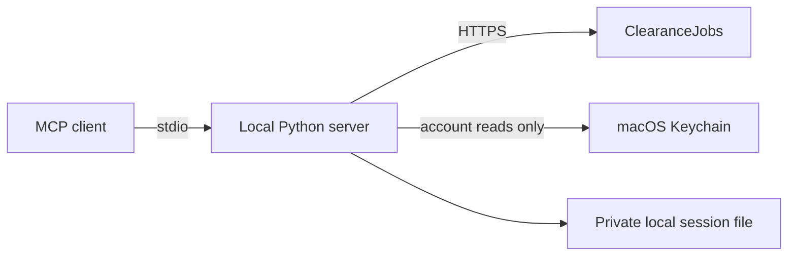
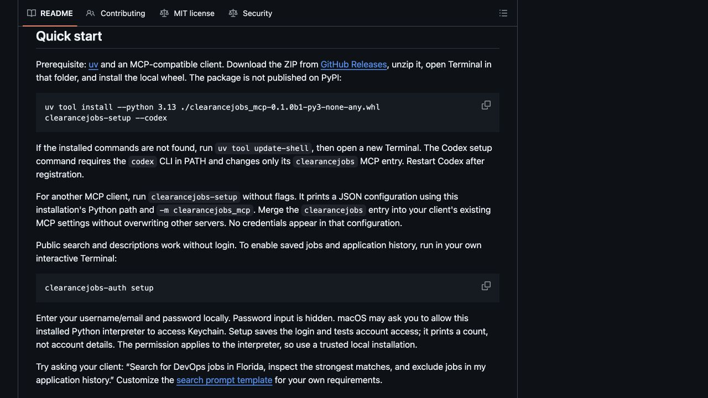
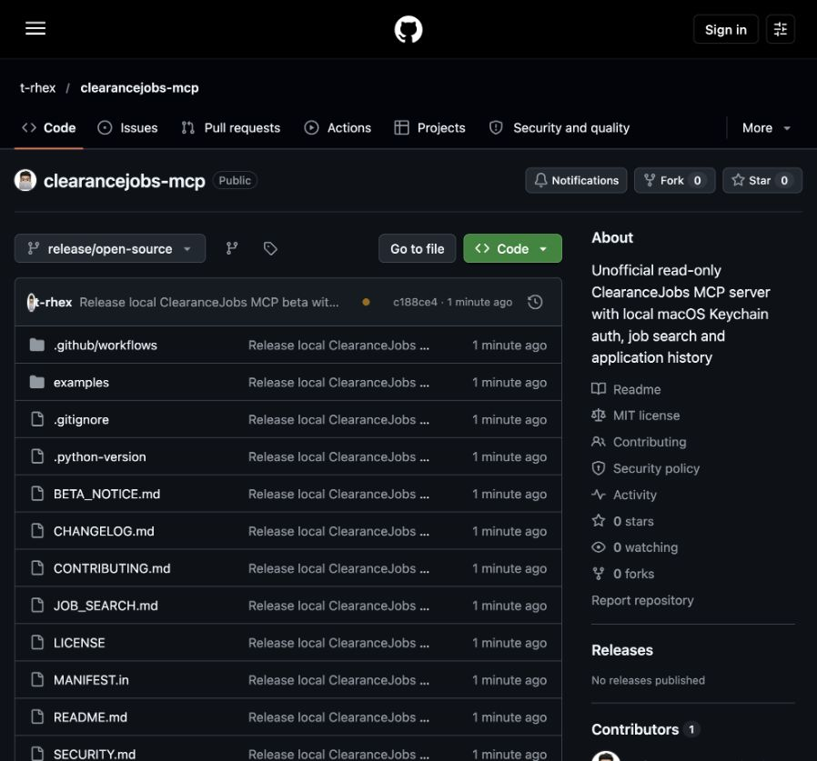

# ClearanceJobs MCP

[](https://github.com/t-rhex/clearancejobs-mcp/actions/workflows/ci.yml)
[](LICENSE)
[](pyproject.toml)

Search ClearanceJobs and read your saved jobs, application history and full job
descriptions from a local MCP client. This is an unofficial, read-only integration.
It does not apply for jobs or send messages. Nothing is hosted, and your credentials
stay on your Mac. Information returned to an AI client is handled under that
client's own data settings.

**Status:** version 0.1.0b1, early open-source beta.
macOS and Python 3.13+ are required for the supported beta. One ClearanceJobs
account per macOS user is supported. The code is [MIT licensed](LICENSE);
see [BETA_NOTICE.md](BETA_NOTICE.md) for separate service-access requirements.

ClearanceJobs' [terms §8.2(aa)](https://about.clearancejobs.com/terms-of-service)
restrict search/retrieval applications without prior written authorization.
Confirm authorization before using this integration or inviting testers. Technical
access and local credential storage do not establish permission.

## Quick start

Prerequisite: [uv](https://docs.astral.sh/uv/getting-started/installation/) and an
MCP-compatible client. Download the ZIP from [GitHub Releases](https://github.com/t-rhex/clearancejobs-mcp/releases), unzip it, open Terminal in that folder,
and install the local wheel. The package is not published on PyPI:

```sh
uv tool install --python 3.13 ./clearancejobs_mcp-0.1.0b1-py3-none-any.whl
clearancejobs-setup --codex
```

If the installed commands are not found, run `uv tool update-shell`, then open a new
Terminal. The Codex setup command requires the `codex` CLI in PATH and changes only
its `clearancejobs` MCP entry. Restart Codex after registration.

For another MCP client, run `clearancejobs-setup` without flags. It prints a JSON
configuration using this installation's Python path and `-m clearancejobs_mcp`.
Merge the `clearancejobs` entry into your client's existing MCP settings without
overwriting other servers. No credentials appear in that configuration.

Public search and descriptions work without login. To enable saved jobs and
application history, run in your own interactive Terminal:

```sh
clearancejobs-auth setup
```

Enter your username/email and password locally. Password input is hidden. macOS
may ask you to allow this installed Python interpreter to access Keychain. Setup
saves the login and tests account access; it prints a count, not account details.
The permission applies to the interpreter, so use a trusted local installation.

Try asking your client: “Search for DevOps jobs in Florida, inspect the strongest
matches, and exclude jobs in my application history.” Customize the
[search prompt template](JOB_SEARCH.md) for your own requirements.

## Example session

Ask your MCP client:

> Find five DevOps or platform engineering jobs in Florida for someone with five
> years of experience and a Secret clearance. Exclude my previous applications.
> Check full descriptions for clearance upgrades, experience and onsite requirements.
> Explain unknowns and provide original job links. Do not apply for me.

The client reads application history, searches focused terms and inspects full
requirements. A response might look like this **fictional example**, not live jobs:

| Role | Location | Why it fits | Check before applying |
| --- | --- | --- | --- |
| DevOps Engineer · Example Defense | Orlando, onsite | Secret; BS +5 years; Terraform/Kubernetes | Salary unlisted |
| Platform Engineer · Example Systems | Tampa, hybrid | Secret; CI/CD and Linux automation | Confirm onsite days |

Actual ranking is performed by your MCP client using your supplied requirements,
not by a scoring model in this package. Application exclusions cover history
recorded by ClearanceJobs only. See [JOB_SEARCH.md](JOB_SEARCH.md) for a reusable
prompt and [examples/search.py](examples/search.py) for a Python search example.



Search previews are compact; descriptions are fetched only when requested.
Credentials are never returned as tool results. Account data and job descriptions
are returned to the connected client and may be sent to its AI provider.

## Available tools

| Tool | Purpose |
| --- | --- |
| `search_jobs(keywords, remote=false, page=1, limit=10, state=null)` | Newest jobs; `state="FL"` filters Florida; omit for nationwide |
| `get_saved_jobs(page=1, limit=20)` | Saved listings, dates and open/closed flags |
| `get_applications(page=1)` | Application history, dates and original statuses |
| `get_job_details(job_id)` | Full readable description and published structured requirements |

Follow all history pages and compare `job_id` to exclude applications reliably.
Listings are compact; descriptions are untruncated. Remote/Hybrid includes hybrid
work, and multi-location listings need confirmation of the actual assignment.
Other state filters are not implemented. Application history may omit submissions
made elsewhere and does not prove the employer's current review status.

Standalone commands are also installed:

```sh
clearancejobs devops --state FL --limit 5
clearancejobs devsecops --remote --limit 5
clearancejobs --saved
clearancejobs --applications
clearancejobs-auth login
clearancejobs-auth forget
```

The listing commands print account data when requested; avoid sharing their output
unintentionally. `login` explicitly renews once. `forget` removes the Keychain login,
but leaves the existing session valid until expiry or revocation.

## Authentication and privacy

The generic macOS Keychain item uses service `clearancejobs-mcp`, account `login`;
its value contains username and password. Secrets are never command arguments,
MCP tools, or MCP configuration values. They are held in memory during login.
Account data is returned to the requesting MCP client; the app sends no telemetry.

A successful login writes `~/.config/clearancejobs/session.json` atomically with
mode 0600. This file contains authentication cookies and a CSRF token; treat it as
a password. Never share it. Public searches/descriptions send no credentials.
Authenticated requests use fixed HTTPS destinations and refuse redirects.

Account requests log in when the session is missing or returns HTTP 401/419, then
retry once. Renewal uses `session.json.lock` to coordinate threads and processes;
waiters reuse a session already replaced by another request. Keep the lock file in
place. Its presence does not mean a process holds the lock.

HTTP 403, rate limits, network errors and unsafe/malformed session files do not
trigger login. Login failure preserves the old session. MFA, account locks and
verification may require browser sign-in; there is no automated MFA bypass or
browser session-export wizard. The observed token lifetime was roughly two hours.
The site's Remember me remembers the username rather than extending the session.

To remove local access, run `clearancejobs-auth forget`, then remove
`~/.config/clearancejobs/session.json`. This does not revoke the website session;
use the site's session controls if available. To uninstall the package:

```sh
codex mcp remove clearancejobs
uv tool uninstall clearancejobs-mcp
```

Remove the MCP entry manually if using another client. Uninstalling the package
alone does not delete credentials or sessions.

## Develop and verify

From an extracted source distribution or checkout:

```sh
uv sync --locked
uv run python -m unittest -v
uv build
uv run python check_beta.py
```

The tests run offline with fake credentials. The wheel includes only the four
application modules. The source archive uses an explicit file allowlist; neither
includes personal reports, sessions, Keychain items, `.venv`, or machine settings.
The source `server.py` remains a compatibility launcher for existing registrations.

The following checks are **opt-in live checks** using your account and Keychain:

```sh
uv run python check_mcp.py
uv run python check_auth_concurrency.py
```

The first checks four tools and prints counts. The second uses a temporary invalid
session, forces two simultaneous expired account requests, and verifies one login
and two successful retries. Neither submits applications or sends messages.

## Known limits

The integration relies on undocumented endpoints and can break without notice.
Search uses `POST /api/v1/jobs/search`; account tools use `/api/v1/jobs/saved` and
`/api/v1/jobs/applications`. Descriptions come from public JobPosting JSON-LD.
No scheduling, bulk crawling, deployment, save/unsave actions, application
submission or messaging is included. Normal site requests may record analytics.

## Contributing and security

See [CONTRIBUTING.md](CONTRIBUTING.md), [SECURITY.md](SECURITY.md), and
[CHANGELOG.md](CHANGELOG.md). Please redact account details in reports.

## Screenshots

These screenshots show this project's public setup guide and **fictional example**,
not a real account, live listings, or a graphical app interface. This project
runs through an MCP client or Terminal; it does not include a standalone dashboard.




